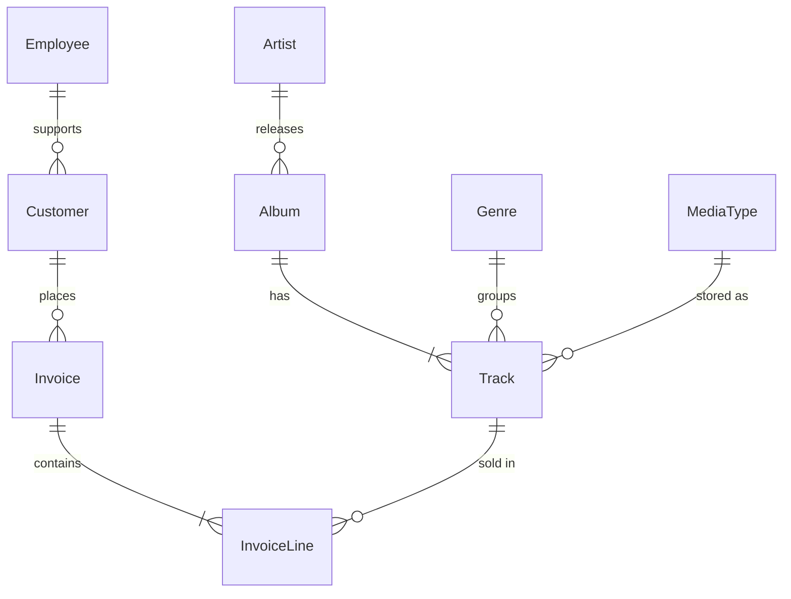
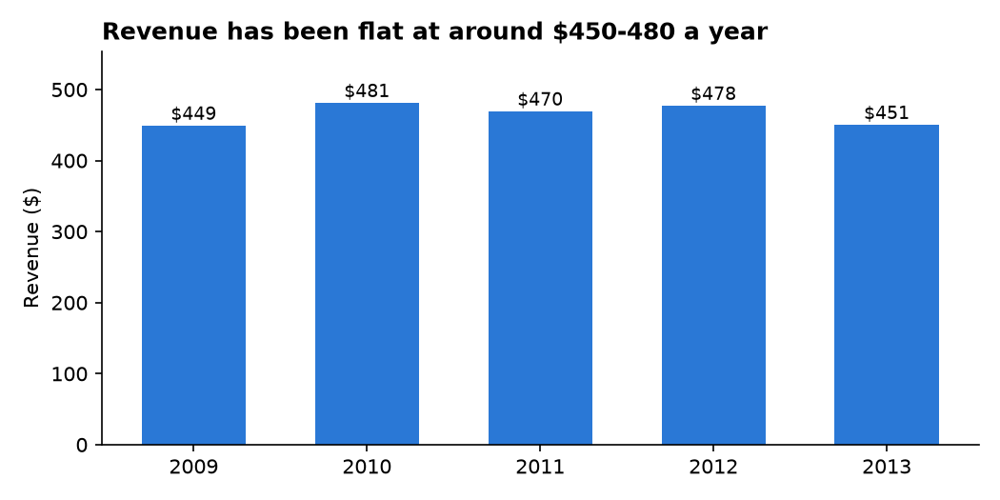
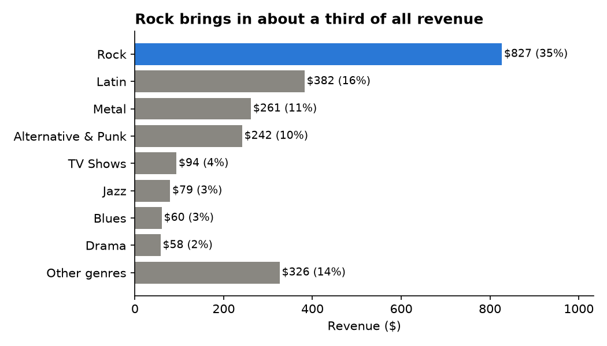
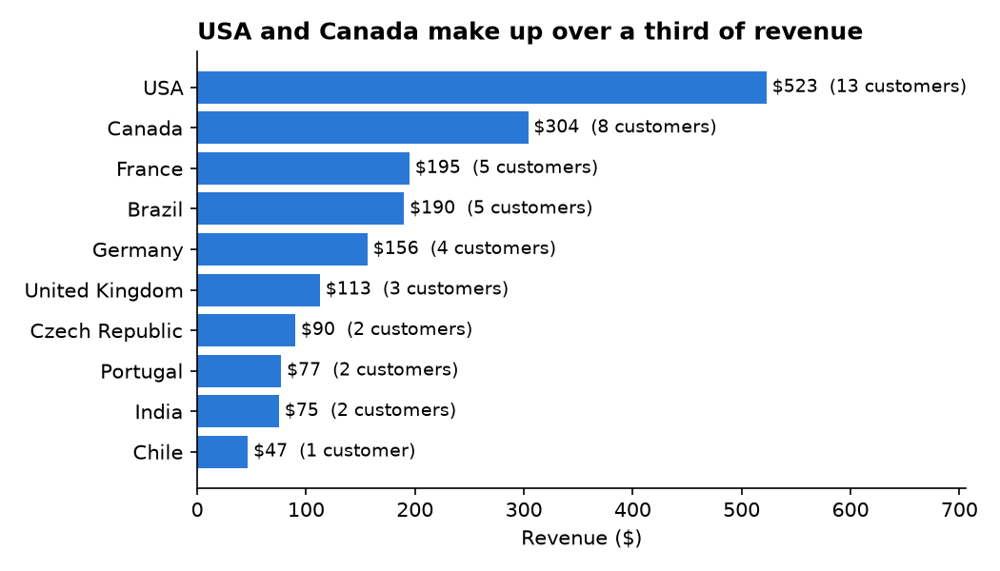
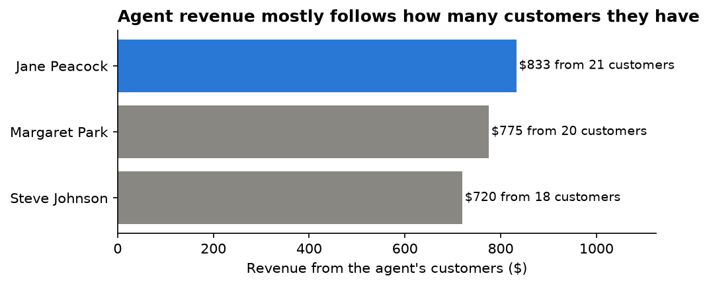

# SQL analysis of a music store database

This is the project I used to practise SQL. I took the Chinook database, a sample database of a digital music store (like an early iTunes), and answered 25 business questions about it. The questions go from simple `SELECT`s up to joins, subqueries, CTEs and window functions.

All queries are in [`queries/`](queries) and the results of every query are in [`results/`](results).

## The data

Chinook has 11 tables: customers, employees, invoices, invoice lines, tracks, albums, artists, genres, media types and playlists. It covers 412 invoices from 59 customers in 24 countries between 2009 and 2013, and a catalogue of 3,503 tracks.



The data is made up for practice, so some patterns are very regular (for example most months have exactly the same revenue). I treated it like a real store anyway and wrote down what I would tell the business.

## Questions I answered

| File | Topics | Questions |
|---|---|---|
| [01_basics.sql](queries/01_basics.sql) | SELECT, WHERE, ORDER BY, GROUP BY | store size, customers by country, longest tracks, price points, revenue by year |
| [02_joins.sql](queries/02_joins.sql) | INNER JOIN across 3-4 tables | best-selling albums, top artists, revenue by genre, media types, sales agents |
| [03_aggregations.sql](queries/03_aggregations.sql) | GROUP BY, HAVING, CASE | country summary, top customers, typical order size, catalogue sell-through by genre, orders by weekday |
| [04_subqueries_ctes.sql](queries/04_subqueries_ctes.sql) | subqueries, CTEs, correlated subqueries | customers above average, top genre per country, top customer per country, unsold tracks, full albums vs single tracks |
| [05_window_functions.sql](queries/05_window_functions.sql) | SUM OVER, LAG, RANK, PARTITION BY | running total, year-over-year change, top artists per genre, days between orders, revenue share |

## What I found

**Revenue is flat.** The store makes about $450-480 a year ($2,328.60 in total over 5 years). 2010 was the best year (+7.1%) and 2013 the worst (-5.6%).



**Rock is a third of the business.** Rock brings in 35.5% of revenue, followed by Latin (16.4%), Metal (11.2%) and Alternative & Punk (10.4%). Rock is the top genre in almost every country. The exceptions are Sweden (Latin) and Argentina (tied between Rock and Alternative & Punk).



**North America is the biggest market.** The USA (22.5%) and Canada (13.1%) together are over a third of revenue. Revenue per customer is about the same everywhere ($38-45), so countries are big because they have more customers, not because customers spend more.



**People buy single tracks, not albums.** Only 2 of 412 orders (0.5%) were a complete album. An average order has 5.4 tracks and is worth $5.65.

**43% of the catalogue has never sold.** 1,519 of 3,503 tracks have no sales at all. Smaller genres are the worst: only 35% of Alternative and 37% of Electronica/Dance tracks have ever sold, against 57-62% for Rock, Latin and Metal (query Q14).

**Iron Maiden, U2 and Metallica are the top artists**, with $138.60, $105.93 and $90.09 in sales. Iron Maiden appears in the top 3 of both Rock and Metal.

**Sales agents are fairly even.** Jane Peacock's customers spent the most ($833), but she also looks after the most customers (21). Per customer, all three agents are within $1.25 of each other ($38.77 to $40.01).



**Customers come back about every 8 months.** The average gap between two orders from the same customer is 235 days.

## If this were a real store, I'd suggest

1. Promote albums as bundles (for example a small discount for buying a full album), since almost nobody buys them now.
2. Look at the 43% of tracks that never sold. Either promote them or stop paying to host them.
3. Focus marketing on growing the customer count in the USA, Canada and Europe, because spend per customer is already similar everywhere.
4. Send reminder emails, since customers only come back every ~8 months.

## A few queries I liked writing

Top genre in each country (correlated subquery):

```sql
WITH genre_country AS (
    SELECT c.Country, g.Name AS genre, SUM(il.Quantity) AS units
    FROM InvoiceLine il
    JOIN Invoice  i ON i.InvoiceId  = il.InvoiceId
    JOIN Customer c ON c.CustomerId = i.CustomerId
    JOIN Track    t ON t.TrackId    = il.TrackId
    JOIN Genre    g ON g.GenreId    = t.GenreId
    GROUP BY c.Country, g.Name
)
SELECT gc.Country, gc.genre, gc.units
FROM genre_country gc
WHERE gc.units = (SELECT MAX(units) FROM genre_country x WHERE x.Country = gc.Country)
ORDER BY gc.units DESC, gc.Country;
```

Year-over-year change with `LAG`:

```sql
WITH yearly AS (
    SELECT strftime('%Y', InvoiceDate) AS year, SUM(Total) AS revenue
    FROM Invoice
    GROUP BY year
)
SELECT year,
       ROUND(revenue, 2) AS revenue,
       ROUND(revenue - LAG(revenue) OVER (ORDER BY year), 2) AS change,
       ROUND(100.0 * (revenue - LAG(revenue) OVER (ORDER BY year))
             / LAG(revenue) OVER (ORDER BY year), 1) AS pct_change
FROM yearly
ORDER BY year;
```

## What I learned

- Writing the question in plain English first made the query much easier to write.
- Revenue should come from `InvoiceLine` (price × quantity) when I need it per track or genre, and from `Invoice.Total` when I need it per order or customer. Mixing them up double counts.
- `RANK()` keeps ties, which matters. In Q23 two artists tie for 3rd place in Metal.
- `NOT IN` with a subquery is easy to read. But if the subquery can return NULLs it silently returns nothing, so `NOT EXISTS` or a `LEFT JOIN` is safer.
- Date functions are different in every database. I used SQLite's `strftime`; in MySQL it would be `YEAR()` / `DATE_FORMAT()` and in PostgreSQL `EXTRACT()` / `TO_CHAR()`.

## How to run it

The database file is included in `data/`, so nothing needs to be downloaded.

```bash
pip install -r requirements.txt
python run_queries.py    # runs every query and writes results/*.md
python make_charts.py    # makes the charts in images/
```

You can also open `data/chinook.sqlite` in [DB Browser for SQLite](https://sqlitebrowser.org/) and paste any query from `queries/`.

## Credits

Chinook database by Luis Rocha, from [github.com/lerocha/chinook-database](https://github.com/lerocha/chinook-database) (licence in [`data/CHINOOK_LICENSE.md`](data/CHINOOK_LICENSE.md)).
